# EWB Student Management System — Full-Stack Application

[](https://fastapi.tiangolo.com)
[](https://react.dev)
[](https://sqlite.org)
[](https://alembic.sqlalchemy.org)
[](https://ai.google.dev)
[](https://docs.pytest.org)

A robust, enterprise-grade Student Management System developed for the **EWB Edu Tech Python Backend Development** assignment. The system satisfies every mandatory requirement: comprehensive CRUD student management, server-side filtering and sorting, pagination, aggregate analytics with dynamic visualizations, persistent SQLite storage across restarts, automated migration management via Alembic, automated unit & integration test suites, and an optional data-grounded AI assistant powered by Google Gemini.

---

##  Table of Contents
- [Architecture & Design](#-architecture--design)
- [Key Features](#-key-features)
- [Technology Stack](#-technology-stack)
- [Repository Structure](#-repository-structure)
- [Prerequisites](#-prerequisites)
- [Quick Start Guide](#-quick-start-guide)
  - [1. Backend Setup](#1-backend-setup)
  - [2. Database Migrations & Seeding](#2-database-migrations--seeding)
  - [3. Frontend Setup](#3-frontend-setup)
- [Environment Configuration](#-environment-configuration)
- [API Documentation & Endpoints](#-api-documentation--endpoints)
- [AI Assistant & Grounded Queries](#-ai-assistant--grounded-queries)
- [Running Automated Tests](#-running-automated-tests)
- [Production Build](#-production-build)
- [Limitations & Future Enhancements](#-limitations--future-enhancements)

---

## 🏛 Architecture & Design

The application follows a clean, decoupled monorepo architecture separating the presentation layer (React + Vite SPA) from business and data services (FastAPI + SQLAlchemy + SQLite).

```mermaid
graph TD
    Client[React 19 + TypeScript Dashboard] -->|Axios REST / JSON| FastAPIRouter[FastAPI API Router]
    
    subgraph Backend [FastAPI Application]
        FastAPIRouter --> StudentsEndpoint["/students (CRUD, Search, Filter)"]
        FastAPIRouter --> StatsEndpoint["/students/stats (Analytics Aggregation)"]
        FastAPIRouter --> HealthEndpoint["/health, /health/ready (Liveness & DB check)"]
        FastAPIRouter --> AIEndpoint["/ai/query (Grounded Natural Language Assistant)"]
        
        StudentsEndpoint --> CRUDStudent[Student CRUD Repository]
        StatsEndpoint --> CRUDStudent
        
        AIEndpoint --> AIService[AI Intent Classification & Grounding]
        AIService --> CRUDStudent
        AIService -. Optional LLM .-> GeminiAPI[Google Gemini 1.5 Flash]
        
        CRUDStudent --> SQLAlchemy[SQLAlchemy 2.0 ORM Engine]
    end
    
    subgraph Persistence [Data Tier]
        SQLAlchemy --> SQLite[(SQLite Persistent Database)]
        Alembic[Alembic Database Migrations] --> SQLite
    end
```



---

##  Key Features

### 1. Student Records Management
- **Full Student Profile**: Automatically generated unique student ID, full name, date of birth, age (computed dynamically), unique email address, phone number, academic program/course, optional address, enrollment date, and created/updated timestamps.
- **Strict Validation**: Validated via Pydantic on the backend and Zod + React Hook Form on the frontend.
- **REST CRUD Operations**:
  - `POST /students`: Create student (returns HTTP 201, detects duplicate emails with HTTP 409).
  - `GET /students`: List with search, filtering, sorting, and pagination.
  - `GET /students/{id}`: Detailed record inspection (HTTP 404 if missing).
  - `PUT /students/{id}`: Full replacement with email uniqueness validation.
  - `PATCH /students/{id}`: Partial update without overwriting omitted fields.
  - `DELETE /students/{id}`: Permanent deletion with confirmation safeguard.

### 2. Search, Filtering, Sorting & Pagination
- **Search**: Substring search across student name, email, and contact number.
- **Filters**: Filter by academic course/program, enrollment date range (`enrollment_start`, `enrollment_end`), and birth date range.
- **Sorting**: Multi-column sorting (`id`, `full_name`, `email`, `course`, `date_of_birth`, `enrollment_date`, `created_at`) with ascending/descending control.
- **Pagination**: Configurable `page` and `page_size` parameters with total counts and total pages metadata.

### 3. Analytics & Real-Time Dashboard
- Total registered students KPI.
- Distribution of students across academic courses (rendered with Recharts Bar Chart).
- Monthly registration velocity / enrollment trends (rendered with Recharts Line Chart).
- Demographic age breakdown (`<18`, `18-21`, `22-25`, `26+`) dynamically calculated from dates of birth.
- Quick view of most recently registered students.

### 4. Optional Grounded AI Assistant
- Natural language inquiries (e.g. *"How many students are currently registered?"*, *"Which course has the most students?"*, *"Show students born after 2003-01-01"*).
- **Safe, Read-Only Data Grounding**: Translates user intent into deterministic database queries. Never runs arbitrary raw SQL or alters records.
- Gracefully works in offline/deterministic fallback mode when `GEMINI_API_KEY` is not provided.

---

## 🛠 Technology Stack

### Backend
- **Python 3.10+ / 3.11+**
- **FastAPI** — High-performance asynchronous web framework
- **Uvicorn** — ASGI production server
- **SQLite3** — Serverless, zero-config persistent relational database
- **SQLAlchemy 2.0** — Modern Python SQL toolkit and ORM
- **Alembic** — Database migration environment
- **Pydantic v2 & Pydantic-Settings** — Robust validation and settings management
- **Email-Validator** — RFC-compliant email verification
- **Google GenAI SDK** — Gemini 1.5 Flash integration
- **Pytest & HTTPX** — Automated testing suite

### Frontend
- **React 19** with **TypeScript**
- **Vite** — Next-generation frontend build tool
- **Tailwind CSS** — Modern utility-first styling
- **React Router v7** — Declarative client-side routing
- **Axios** — Typed HTTP client with centralized error interception
- **React Hook Form & Zod** — Type-safe form validation and state management
- **Recharts** — Responsive SVG charting library
- **Lucide React** — Crisp icon system
- **Vitest & React Testing Library** — Frontend component unit testing

---

##  Repository Structure

```
ewb-student-management/
├── backend/
│   ├── alembic/                 # Alembic migration scripts and environment
│   │   ├── versions/            # Migration version files
│   │   └── env.py               # Database engine & metadata binding
│   ├── app/
│   │   ├── api/
│   │   │   └── api_v1/
│   │   │       ├── endpoints/   # API route handlers (students, health, ai)
│   │   │       └── api.py       # API router aggregator
│   │   ├── core/                # Config, database engine, logging
│   │   ├── crud/                # Repository data-access methods
│   │   ├── models/              # SQLAlchemy Student ORM model
│   │   ├── schemas/             # Pydantic request & response schemas
│   │   ├── services/            # Grounded AI assistant service
│   │   └── main.py              # FastAPI application entry point
│   ├── tests/                   # Pytest test suite (CRUD, search, stats, AI)
│   ├── alembic.ini              # Alembic configuration
│   ├── requirements.txt         # Backend Python dependencies
│   ├── seed.py                  # Sample data seeder
│   └── .env.example             # Backend environment template
├── frontend/
│   ├── src/
│   │   ├── components/
│   │   │   ├── layout/          # Sidebar, Header, Layout
│   │   │   └── ui/              # Button, Card, Badge, Modal
│   │   ├── pages/               # Dashboard, Directory, Form, Details, AI
│   │   ├── services/            # Axios API client
│   │   ├── types/               # TypeScript interfaces & types
│   │   ├── test/                # Vitest & RTL test suites
│   │   ├── App.tsx              # Application route tree
│   │   ├── index.css            # Tailwind directives & theme
│   │   └── main.tsx             # React entry point
│   ├── package.json             # Frontend dependencies & scripts
│   ├── vite.config.ts           # Vite & Vitest configuration
│   ├── tailwind.config.js       # Tailwind CSS configuration
│   └── .env.example             # Frontend environment template
├── .gitignore                   # Monorepo gitignore
└── README.md                    # Comprehensive documentation
```

---

##  Quick Start Guide

### 1. Backend Setup

1. Open a terminal in the `backend/` directory:
   ```bash
   cd backend
   ```
2. Create and activate a Python virtual environment:
   ```bash
   # Windows (PowerShell)
   python -m venv venv
   .\venv\Scripts\Activate.ps1

   # Linux / macOS
   python3 -m venv venv
   source venv/bin/activate
   ```
3. Install backend dependencies:
   ```bash
   pip install -r requirements.txt
   ```
4. Copy the environment template:
   ```bash
   cp .env.example .env
   ```

### 2. Database Migrations & Seeding

1. Run Alembic migrations to create tables in `students.db`:
   ```bash
   alembic upgrade head
   ```
2. (Optional) Populate the database with 18 realistic sample student records:
   ```bash
   python seed.py
   ```
3. Start the FastAPI backend server:
   ```bash
   uvicorn app.main:app --reload --port 8000
   ```
   *The backend will be available at `http://localhost:8000` with interactive Swagger docs at `http://localhost:8000/docs`.*

### 3. Frontend Setup

1. In a new terminal, navigate to the `frontend/` directory:
   ```bash
   cd frontend
   ```
2. Install frontend dependencies:
   ```bash
   npm install
   ```
3. Copy the environment template:
   ```bash
   cp .env.example .env
   ```
4. Start the Vite development server:
   ```bash
   npm run dev
   ```
   *Open your browser and navigate to `http://localhost:5173`.*

---

## ⚙ Environment Configuration

### Backend (`backend/.env`)
| Variable | Description | Default |
| :--- | :--- | :--- |
| `PROJECT_NAME` | Name of the application | `EWB Student Management System` |
| `API_V1_STR` | API route prefix | `/api/v1` |
| `DATABASE_URL` | SQLAlchemy database connection URI | `sqlite:///./students.db` |
| `BACKEND_CORS_ORIGINS` | JSON list or comma-separated allowed origins | `["http://localhost:5173","http://localhost:3000"]` |
| `GEMINI_API_KEY` | Optional Google Gemini API Key | *(empty - uses local deterministic engine)* |
| `GEMINI_MODEL` | Gemini model identifier | `gemini-1.5-flash` |

### Frontend (`frontend/.env`)
| Variable | Description | Default |
| :--- | :--- | :--- |
| `VITE_API_BASE_URL` | Base endpoint for backend requests | `http://localhost:8000/api/v1` |

---

## 📡 API Documentation & Endpoints

Interactive Swagger UI documentation is accessible at:  
👉 **`http://localhost:8000/docs`**

### Student Endpoints
| Method | Endpoint | Description | Status Code |
| :--- | :--- | :--- | :--- |
| `GET` | `/students` | List students with search, filters, sorting, and pagination | `200 OK` |
| `POST` | `/students` | Enroll a new student | `201 Created` |
| `GET` | `/students/{id}` | Retrieve single student by ID | `200 OK` / `404 Not Found` |
| `PUT` | `/students/{id}` | Replace entire student record | `200 OK` / `409 Conflict` |
| `PATCH` | `/students/{id}` | Partially update student fields | `200 OK` / `409 Conflict` |
| `DELETE` | `/students/{id}` | Delete a student record | `200 OK` / `404 Not Found` |
| `GET` | `/students/stats` | Aggregate dashboard statistics | `200 OK` |

### System & Health Endpoints
| Method | Endpoint | Description |
| :--- | :--- | :--- |
| `GET` | `/health` | Liveness check |
| `GET` | `/health/ready` | Readiness check with live SQLite ping |

### Example cURL Commands

**Create a Student:**
```bash
curl -X POST "http://localhost:8000/students" \
  -H "Content-Type: application/json" \
  -d '{
    "full_name": "Kavya Sharma",
    "email": "kavya.sharma@example.com",
    "date_of_birth": "2003-05-12",
    "phone_number": "+91 98765 43210",
    "course": "Computer Science",
    "address": "42 Tech Park, Bengaluru",
    "enrollment_date": "2025-08-01"
  }'
```

**List Students with Filtering & Sorting:**
```bash
curl "http://localhost:8000/students?course=Computer+Science&sort_by=full_name&sort_order=asc&page=1&page_size=10"
```

---

##  AI Assistant & Grounded Queries

The optional AI Assistant allows natural language queries about the database.

### How Grounding Works
1. User enters natural question in the frontend (e.g. *"How many students are enrolled in Data Science?"*).
2. The backend interprets the query intent (e.g. `students_by_course`, `course="Data Science"`).
3. The backend executes a **deterministic, read-only** SQLAlchemy query.
4. The verified result is formulated into a response with structured preview evidence.
5. If `GEMINI_API_KEY` is present, Gemini 1.5 Flash provides natural language synthesis. If absent, the built-in deterministic engine provides the exact answer without external dependencies!

---

##  Running Automated Tests

### Backend Tests (Pytest)
The backend test suite verifies all CRUD operations, duplicate conflicts, validation rules, search and filters, sorting, analytics calculations, health endpoints, and isolation (using an isolated temporary SQLite database).
```bash
cd backend
.\venv\Scripts\pytest.exe -v
```

### Frontend Tests (Vitest)
The frontend tests verify component rendering, user interactions, form validation, error handling, and mock API integration:
```bash
cd frontend
npm run test
```

---

##  Production Build

To verify and build the frontend for production:
```bash
cd frontend
npm run build
```
The optimized static bundle is generated in `frontend/dist/`.

---

##  Limitations & Future Enhancements
- **Multi-Tenant Roles**: Currently provides a single administrator view without authentication (per assignment instruction). In future releases, role-based access control (RBAC) with JWT tokens can be introduced.
- **Bulk CSV Export / Import**: A utility to export and import student records in standard CSV/Excel format.
- **Audit History**: Historical audit log table tracking individual field updates over time.

---

*Developed for the EWB Edu Tech internship evaluation.*
